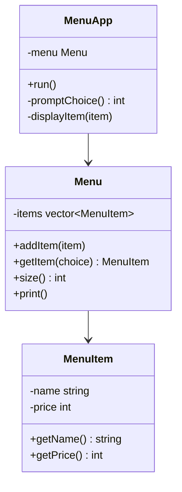

Họ và tên: **Nguyễn Mạnh Cường**

MSSV: **25127024**

# B. Requirements

## 1. Class diagram

## 2. Giải thích lý do thiết kế

### Trách nhiệm của từng object

- **MenuItem**: đại diện cho một món ăn duy nhất, chịu trách nhiệm lưu trữ và bảo vệ dữ liệu của chính món đó (tên, giá). Không biết gì về danh sách món hay giao diện người dùng.
- **Menu**: quản lý tập hợp các `MenuItem` — thêm món, đếm số lượng, tra cứu một món theo lựa chọn của người dùng, in danh sách món ra màn hình. Không biết gì về vòng lặp nhập/xuất của chương trình.
- **MenuApp**: điều phối luồng tương tác với người dùng — hiển thị menu, đọc lựa chọn, nhờ `Menu` tra cứu món tương ứng, hiển thị kết quả, lặp lại cho đến khi người dùng chọn thoát. Không biết gì về cách `Menu` lưu trữ dữ liệu bên trong.

Mỗi lớp chỉ đảm nhận một trách nhiệm và chỉ có một lý do để thay đổi: đổi cách lưu trữ món ăn → chỉ sửa `Menu`; đổi cách hỏi người dùng → chỉ sửa `MenuApp`; đổi thông tin của một món ăn → chỉ sửa `MenuItem`.

### Tại sao chọn thiết kế này? Tại sao dùng class chứ không phải struct?

Bản gốc dùng `struct MenuRepository` với hai `vector` song song (`items` và `prices`) — đây là kiểu thiết kế mảng song song (parallel array): dữ liệu bị tách rời khỏi hành vi thao tác trên nó, không có ràng buộc nào đảm bảo hai mảng luôn cùng độ dài hoặc giá trị hợp lệ, và mọi nơi trong chương trình đều có thể đọc/ghi trực tiếp vào các trường public mà không qua kiểm soát nào.

Thiết kế OOP tách `MenuItem`, `Menu`, `MenuApp` thành ba lớp riêng biệt, mỗi lớp dùng `class` (thành viên mặc định là private) thay vì `struct` vì:

- **Đóng gói (encapsulation)**: dữ liệu của một món ăn (tên, giá) luôn đi kèm với hành vi thao tác trên nó, không bị sửa đổi tuỳ tiện từ bên ngoài.
- **Bảo toàn tính hợp lệ**: constructor của `MenuItem` có thể kiểm tra ràng buộc (ví dụ giá không âm) ngay khi khởi tạo, đảm bảo đối tượng luôn ở trạng thái hợp lệ.
- **Ẩn chi tiết cài đặt**: nếu sau này thay đổi cách `Menu` lưu trữ các món ăn bên trong, các lớp khác sử dụng `Menu` (như `MenuApp`) không cần biết hay thay đổi gì.

Về mặt kỹ thuật, `struct` và `class` trong C++ giống nhau (chỉ khác mức truy cập mặc định), nhưng theo quy ước, `struct` nên dùng cho các đối tượng dữ liệu thuần tuý không có bất biến hay logic đi kèm, còn `class` dùng khi đối tượng cần đóng gói dữ liệu cùng hành vi và bảo vệ tính hợp lệ của trạng thái bên trong — đúng với vai trò của `MenuItem` và `Menu` trong hệ thống này.

## 3. Cách lấy menu item dựa trên lựa chọn của người dùng

Lớp `Menu` cung cấp phương thức `getItem(choice)`: nhận vào lựa chọn của người dùng, kiểm tra lựa chọn có nằm trong phạm vi hợp lệ của danh sách món hay không, nếu hợp lệ thì trả về `MenuItem` tương ứng, nếu không hợp lệ thì báo hiệu lỗi (thay vì truy cập trực tiếp vào mảng theo chỉ số như bản gốc, vốn không kiểm tra biên và có thể gây lỗi truy cập ngoài phạm vi khi người dùng nhập sai). Nhờ vậy, `MenuApp` không cần tự tính toán chỉ số hay truy cập trực tiếp vào cấu trúc dữ liệu bên trong của `Menu`.

## 4. Nếu thêm mô tả (description) cho mỗi món ăn, cần sửa những class nào?

Chỉ cần sửa lớp **MenuItem**: thêm thuộc tính `description` cùng phương thức truy cập tương ứng (ví dụ `getDescription()`).

Các lớp `Menu` và `MenuApp` không cần thay đổi cấu trúc: `Menu` chỉ lưu trữ và duyệt qua danh sách `MenuItem` mà không quan tâm đến số lượng thuộc tính bên trong mỗi món; `MenuApp` chỉ cần bổ sung việc gọi `getDescription()` tại nơi hiển thị kết quả cho người dùng, mà không cần sửa logic điều khiển luồng chương trình.

Đây là lợi ích rõ rệt so với thiết kế mảng song song ban đầu: nếu dùng parallel array, việc thêm mô tả sẽ đòi hỏi thêm một `vector<string> descriptions` thứ ba và phải cập nhật đồng bộ ở mọi nơi dùng chỉ số để tra cứu — dễ dẫn đến sai sót khi các mảng lệch độ dài với nhau.
